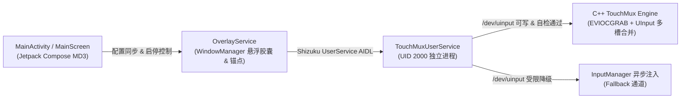

# 零断触连点器 (ZeroInterruptClicker)

面向 Android 手游与平板多指交互场景设计的 **硬件级零断触自动化连点工具**。基于 **Shizuku 特权服务 + Native C++ `TouchMux` (`/dev/uinput` 多点触控硬件合流)** 架构，结合 **Material Design 3（Material You 动态取色 + 日夜自适应）** 主界面与**三态可折叠贴边悬浮胶囊**，实现左手摇杆持续移动、右手视野滑动与自动连点并发注入互不打断。

> [!NOTE]
> 本项目仅使用标准 Android Accessibility 无关的 Shizuku 跨进程输入合流方案，核心输入合并由 C++ Native 层在 `/dev/input` 与 `/dev/uinput` 节点之间完成；在 `/dev/uinput` 受 SELinux 策略限制的设备上会自动降级为 Shizuku `InputManager` 异步注入通道。

---

## 核心特性

| 模块 | 核心能力 | 实现机制 |
| :--- | :--- | :--- |
| **硬件级零断触注入** | 物理触屏事件与连点锚点事件在虚拟触摸屏硬件层面合并上报，互不抢占 `MotionEvent` 流 | `EVIOCGRAB` + `/dev/uinput` 多槽位 `ABS_MT_SLOT` 合成（`touch_mux.cpp`） |
| **5 秒安全自检回滚** | 开启硬件接管前强制 5 秒确认保护；超时或主动撤销立即释放 `EVIOCGRAB` 与虚拟设备 | Shizuku UID 2000 守护定时器 + 主界面实时倒计时弹窗 |
| **Material Design 3 UI** | Android 12+ Material You 壁纸动态取色、日夜自动切换，适配手机单栏与平板横屏双栏 | Jetpack Compose + Material 3 + `DynamicColors` |
| **多预设方案 & 自动保存** | 支持创建多套预设方案并预配锚点坐标与毫秒参数，**无保存按钮、任意修改实时自动保存** | `ClickConfigStore` JSON 持久化 + `OverlayStateHub` 双向同步 |
| **极简三态折叠悬浮窗** | 初始仅显示贴边按钮、三角形 Play 按钮、一键切换方案按钮及对称展开按钮，其余操作全部折叠 | `ControlBarView` 三态视图 + `WindowManager` 零重排状态刷新 |
| **经典涟漪触控反馈** | 悬浮胶囊按钮、端盖、微调面板及未锁定锚点全面配备经典水波纹点按反馈 | 原生 `RippleDrawable` + Compose Material 3 Ripple |

---

## 工作架构



---

## 悬浮控制胶囊交互说明

- **初始精简形态**：仅显示 **顶部贴边按钮（`<` / `>`）**、**开始/停止连点（▶ / ■）**、**一键切换方案（带编号徽标 `1..N`）** 与 **底部工具展开按钮（`∨`，顶部横向箭头旋转 90° 的对称样式）**。
- **工具展开形态**：点击底部 `∨` 向下展开 `+`（添加锚点）、`-`（删除选中锚点）、`🔒`（锁定穿透 / 解锁拖动）、`⚙`（单点微调面板）、`✕`（退出悬浮窗）；再点 `∧` 折回精简态。
- **贴边迷你胶囊**：点击顶部 `<` / `>`、开始连点约 1.5 秒后或闲置约 4.5 秒后（开启自动收边时）自动贴靠左/右边缘并缩为 `26dp × 74dp` 小胶囊，支持拖过屏幕中线自动换边停靠。

---

## 环境要求与构建方法

### 运行环境
- **系统版本**：Android 8.0 及以上（`minSdk = 26`，`targetSdk = 35`），推荐 Android 12+ 以体验完整 Material You 动态取色。
- **前置权限**：
  1. 悬浮窗显示权限（`SYSTEM_ALERT_WINDOW`）；
  2. 已安装并激活 **Shizuku**（无线调试 / ADB 模式或 Root 模式均可），并对本应用授权；
  3. Android 13+ 建议开启通知权限以稳定保活前台服务。

### 本地源码编译
- **构建工具链**：JDK 17、Gradle `9.3.1`、AGP `9.1.0`、NDK `28.2.13676358`（`arm64-v8a` / `x86_64`）。
- 克隆仓库并在 `local.properties` 配置本地 `sdk.dir` 后执行：

```bash
# 编译 Debug 与 Release APK
./gradlew :app:assembleDebug :app:assembleRelease
```

---

## 免责声明

本项目仅供个人安卓技术研究、输入子系统学习与无障碍辅助场景使用，请遵守各应用与游戏的用户协议及当地法律法规。
